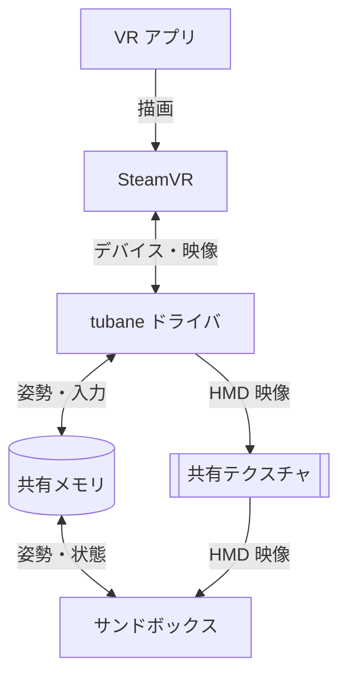
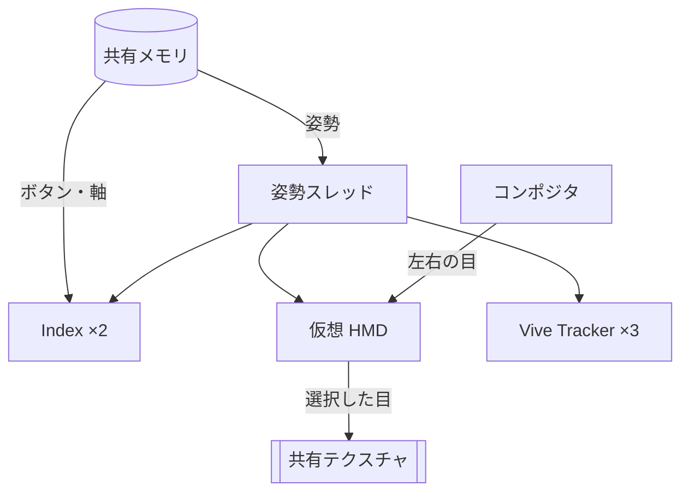
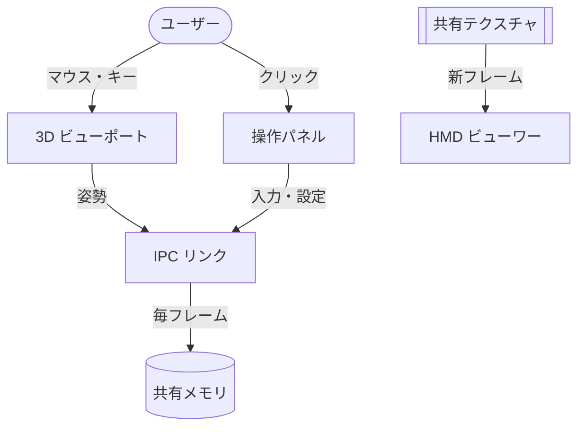

# tubaneVR

**物理的な VR 機器を一切使わずに、PC 単体で SteamVR 環境を完全にエミュレートするための開発・デバッグ・VRSNS 用ツールです。**

SteamVR に仮想の HMD・Valve Index コントローラー（左右）・HTC Vive Tracker（初期値 3 台）を認識させ、
それらの位置・姿勢・ボタン入力を PC 上の 3D サンドボックス GUI からマウス / キーボードで自由に操作できるようにします。

> **現在の進捗: Step 3（HMD 映像出力ビューワー）完了**
> 残りの課題（骨格入力・速度の算出など）は [ロードマップ](#ロードマップ) を参照してください。

---

## 目次

1. [構成概要](#構成概要)
2. [動作要件](#動作要件)
3. [ディレクトリ構成](#ディレクトリ構成)
4. [ビルド方法](#ビルド方法)
5. [SteamVR への登録](#steamvr-への登録)
6. [動作確認](#動作確認)
7. [tubane-sandbox の使い方](#tubane-sandbox-の使い方)
8. [tubane_shm_probe の使い方](#tubane_shm_probe-の使い方)
9. [設定項目 (default.vrsettings)](#設定項目-defaultvrsettings)
10. [仮想デバイス一覧](#仮想デバイス一覧)
11. [座標系](#座標系)
12. [トラブルシューティング](#トラブルシューティング)
13. [ロードマップ](#ロードマップ)
14. [関連ドキュメント](#関連ドキュメント)

---

## 構成概要

### 全体概要



- **tubane ドライバ**（`driver_tubane.dll`）は SteamVR にロードされ、仮想の HMD・Index コントローラー・Vive トラッカーを SteamVR に見せます
- **サンドボックス**（`tubane_sandbox.exe`）は、デバイスをマウスで動かしたりボタンを押したりする GUI です
- 両者は **共有メモリ**（姿勢・入力・設定・接続状態）と **共有テクスチャ**（HMD の映像）でつながっています。ネットワークは使いません
- VR アプリから見ると、実機の HMD とコントローラーが接続されているのと同じ状態になります

### VR サーバー内部（ドライバ）



- **姿勢スレッド** は約 500Hz で共有メモリを読み、全デバイスの位置・回転を SteamVR に通知します
- **Index ×2** は Valve Index コントローラーとして振る舞い、ボタン・トリガー・スティック・指カールの値を SteamVR に送ります（変化した値だけ）
- **Vive Tracker ×3** は腰・左足・右足のロールで登録されます（台数は 0〜8 で変更可）
- **仮想 HMD** は direct mode で動作し、SteamVR の **コンポジタ** が描いた左右の目の映像を受け取ります。
  サンドボックスで選んだ目だけを FHD / WQHD に拡大縮小して **共有テクスチャ** に書き込みます

### サンドボックス内部



- **3D ビューポート** はルームスケールの箱の中にデバイスを表示します。クリックで選択し、ギズモで移動・回転できます
- **操作パネル** はコントローラーのボタン・アナログ入力、数値での位置・回転編集、解像度やトラッカー数の設定を行います
- **IPC リンク** は編集結果をまとめて毎フレーム共有メモリへ書き込みます（書き込み手はサンドボックス 1 つだけ）
- **HMD ビューワー** は共有テクスチャに新しいフレームが来るたびにコピーして表示します。左目 / 右目の切替、等倍表示、別ウィンドウへのポップアウトができます

詳しいデータ構造や同期の仕組みは [docs/ipc.md](docs/ipc.md)、設計の詳細は [docs/architecture.md](docs/architecture.md) を参照してください。

| コンポーネント | 言語 / 技術 | 役割 |
|---|---|---|
| `tubane-driver` (`driver_tubane.dll`) | C++20, OpenVR Driver API | SteamVR にロードされ、仮想デバイスをスポーンする |
| `tubane-sandbox` | C++20, D3D11, Dear ImGui, ImGuizmo | 3D 空間上でデバイスを操作し、HMD 映像を表示する |
| `common` | ヘッダオンリー C++ | 共有メモリ構造体・SeqLock・初期配置を driver / sandbox で共有 |
| `tubane_shm_probe` | C++ コンソールツール | GUI 無しで共有メモリを読み書きする検証用ツール |

技術選定の理由は [docs/architecture.md](docs/architecture.md) にまとめています。

---

## 動作要件

| 項目 | 要件 |
|---|---|
| OS | Windows 10 / 11 (x64) |
| コンパイラ | Visual Studio 2022 または 2026（「C++ によるデスクトップ開発」ワークロード） |
| CMake | 3.24 以上（Visual Studio 同梱の CMake で可） |
| Git | FetchContent で依存ライブラリを取得するために必要 |
| SteamVR | Steam からインストール済みであること（実機 VR 機器は不要） |
| ネットワーク | 初回 configure 時のみ（OpenVR SDK を GitHub から取得） |

依存ライブラリはすべて CMake の `FetchContent` で自動取得されるため、手動でのダウンロードは不要です。

| ライブラリ | バージョン | 用途 |
|---|---|---|
| [OpenVR SDK](https://github.com/ValveSoftware/openvr) | v2.5.1（`TUBANE_OPENVR_VERSION` で変更可） | `openvr_driver.h`（ヘッダのみ使用。`openvr_api.lib` はリンクしない） |
| [Dear ImGui](https://github.com/ocornut/imgui) | v1.92.9b-docking（`TUBANE_IMGUI_VERSION`） | サンドボックス GUI（docking ブランチ） |
| [ImGuizmo](https://github.com/CedricGuillemet/ImGuizmo) | コミット `105e4fd`（`TUBANE_IMGUIZMO_COMMIT`） | 移動 / 回転ギズモ |

ImGuizmo は上流でリリースタグが管理されていないため、コミットハッシュで固定しています。
サンドボックスが不要な場合は `-DTUBANE_BUILD_SANDBOX=OFF` で ImGui / ImGuizmo の取得とビルドを省略できます。

---

## ディレクトリ構成

| パス | 内容 |
|---|---|
| `driver/` | SteamVR ドライバ（`driver_tubane.dll`）と、SteamVR に登録するフォルダの雛形 |
| `sandbox/` | 3D サンドボックス GUI（`tubane_sandbox.exe`） |
| `common/` | driver と sandbox が共有するヘッダ（共有メモリの構造体など） |
| `tools/` | 検証ツール `tubane_shm_probe`、ドライバの登録 / 解除スクリプト |
| `docs/` | 設計資料（[architecture.md](docs/architecture.md)、[ipc.md](docs/ipc.md)） |
| `cmake/` | 依存ライブラリの自動取得設定 |

---

## ビルド方法

### Visual Studio 2026 の場合

「x64 Native Tools Command Prompt」または PowerShell で実行します。
`cmake` に PATH が通っていない場合は、Visual Studio 同梱の
`C:\Program Files\Microsoft Visual Studio\18\Community\Common7\IDE\CommonExtensions\Microsoft\CMake\CMake\bin\cmake.exe`
を使ってください。

```powershell
cd tubane
cmake --preset vs2026                  # configure（初回のみ OpenVR SDK を取得）
cmake --build --preset vs2026-release  # Release ビルド
# cmake --build --preset vs2026-debug  # Debug ビルド
```

Visual Studio 2022 の場合は `vs2022` / `vs2022-release` プリセットを使用します。
Visual Studio の IDE で「フォルダーを開く」から `tubane` を開いても、プリセットが自動で認識されます。

### ビルド成果物

| パス | 内容 |
|---|---|
| `build/vs2026/package/tubane/` | **SteamVR に登録するドライバフォルダ一式** |
| `build/vs2026/package/tubane/bin/win64/driver_tubane.dll` | ドライバ本体 |
| `build/vs2026/sandbox/<Config>/tubane_sandbox.exe` | 3D サンドボックス GUI |
| `build/vs2026/tools/shm_probe/<Config>/tubane_shm_probe.exe` | 共有メモリ検証ツール |

> SteamVR の起動中は `driver_tubane.dll` がロックされるため、全ターゲットをビルドすると DLL のリンクで失敗します。
> SteamVR を起動したままサンドボックスだけをビルドする場合は
> `cmake --build --preset vs2026-release --target tubane_sandbox` を使ってください。

> **注意:** `driver_tubane.dll` は Debug / Release に関わらず同じ場所に出力されます（登録パスを固定するため）。
> 最後にビルドした構成の DLL が使われます。また、SteamVR 実行中は DLL がロックされるため、
> 再ビルド前に SteamVR を終了してください。

DLL は静的 CRT（`/MT`）でリンクしているため、依存は `KERNEL32.dll` のみです。
VC++ 再頒布可能パッケージの有無に影響されません。

---

## SteamVR への登録

SteamVR を終了した状態で実行します。

```powershell
# ドライバフォルダを SteamVR に登録（ビルドし直すだけで次回起動時に反映される）
powershell -ExecutionPolicy Bypass -File tools\register_driver.ps1
```

### 実機 HMD や他の仮想 HMD ドライバが入っている環境

Virtual Desktop・ALVR・実機 HMD のドライバなどが有効だと、SteamVR はそちらを HMD として選ぶ場合があります。
`-ForceDriver` を付けると `Steam\config\steamvr.vrsettings` に以下を書き込み、tubane の HMD を強制的に使うようにします
（書き換え前に `steamvr.vrsettings.tubane-backup-<日時>` としてバックアップを作成します）。

```jsonc
"steamvr": {
  "forcedDriver": "tubane",
  "activateMultipleDrivers": true
}
```

```powershell
powershell -ExecutionPolicy Bypass -File tools\register_driver.ps1 -ForceDriver
```

### 登録解除

```powershell
powershell -ExecutionPolicy Bypass -File tools\unregister_driver.ps1                      # 登録のみ解除
powershell -ExecutionPolicy Bypass -File tools\unregister_driver.ps1 -RemoveForcedDriver  # forcedDriver も削除
```

`-BuildDir build\vs2022` のように指定すると、別のビルドディレクトリを登録 / 解除できます。

---

## 動作確認

1. ビルドして `register_driver.ps1` で登録する
2. SteamVR を起動する
3. 次の点を確認する
   - SteamVR のステータスウィンドウに **HMD・コントローラー 2 本・トラッカー 3 台** が表示される
   - `<Steam>\logs\vrcompositor.txt` に `Headset is using driver direct mode` と出ている（direct mode。デスクトップに SteamVR のウィンドウは開きません。
     `directMode` を `false` にした場合だけ、左右の目を横に並べた SteamVR の「Headset Window」が開きます）
   - 「設定 → コントローラー → Vive トラッカーを管理」で、トラッカーが腰・左足・右足に割り当てられている
4. `<Steam>\logs\vrserver.txt` を `[tubane]` で検索し、次のようなログが出ていることを確認する

   ```
   [tubane] init: resolution=FHD trackers=3 freq=90.0
   [tubane] shared memory created (Ok)
   [tubane] tracker TUBANE-TRK-00 assigned default role TrackerRole_Waist
   [tubane] activated TUBANE-HMD-0001 (slot 0) as device 0
   ...
   ```

5. `tubane_sandbox.exe` を起動し、メニューバー右端に **SteamVR driver connected** と表示されることを確認する
6. ビューポートでデバイスをクリックし、ギズモでドラッグすると SteamVR 側のデバイスも同じように動く
   （SteamVR の「Headset Window」やミラー表示、または `vrcmd --pollposes` で確認できます）
7. サンドボックスを使わずに確認したい場合は、`tubane_shm_probe status` で driver block の `pid` と `heartbeat` が 0 でないこと、
   各デバイスに `vrId` が割り当てられていることを確認する。`tubane_shm_probe orbit` で HMD の首振りと右手の円運動を再生できます

---

## tubane-sandbox の使い方

`build/vs2026/sandbox/Release/tubane_sandbox.exe` を起動します。SteamVR より先に起動しても後に起動しても構いません
（先に動かしたデバイスの位置は、ドライバが接続した時点で反映されます）。

### 画面構成

<!-- TODO: ここにスクリーンショットを貼る（例: docs/images/sandbox.png） -->

中央に 3D ビューポート、左にデバイス一覧、右に入力と設定のパネルが並びます。
各パネルはドラッグで自由に配置でき、メインウィンドウの外に出すと独立したウィンドウになります。

| パネル | 内容 |
|---|---|
| **Viewport** | ルームスケールの箱とデバイスを 3D 表示。クリックで選択し、ギズモで移動・回転 |
| **Devices** | デバイス一覧。ダブルクリックでカメラを寄せる。`#n` は SteamVR 上のデバイス番号 |
| **Inspector** | 位置・回転を数値で編集。`Connected` / `Tracking valid` で切断やトラッキングロストを再現 |
| **Controller Input** | Index コントローラーのボタン・トリガー・グリップ・スティック・指カール |
| **Driver / Settings** | 接続状態、解像度（FHD / WQHD）、トラッカー数（0〜8）、使用 GPU |
| **HMD Viewer** | 仮想 HMD の映像。左目 / 右目の切替、等倍表示、別ウィンドウ化 |

レイアウトは exe と同じフォルダの `tubane_sandbox.ini` に保存されます。削除すると初期状態に戻ります。

### 操作方法

**デバイスの選択と移動**

| 操作 | 内容 |
|---|---|
| 左クリック | デバイスを選択（空白をクリックで解除、`Esc` でも解除） |
| `W` / `E` / `R` | ギズモを 移動 / 回転 / 両方 に切り替え |
| `X` | ワールド座標 / ローカル座標 を切り替え |
| `Ctrl` + ドラッグ | スナップ（0.05m / 15°） |
| `Space` | 選択中のコントローラーのトリガーを引く |

**カメラ**

| 操作 | 内容 |
|---|---|
| 右ドラッグ | 視点を回す |
| 右ドラッグ中に `WASD` / `QE` | 飛行移動 / 上下（`Shift` で高速） |
| 中ドラッグ | パン |
| ホイール | 前後移動 |
| `Alt` + 左ドラッグ | 注視点を中心に回る |
| `F` | 選択中のデバイスに寄る |

メニューの **Scene → Reset all poses** で全デバイスを初期配置に戻せます。

### HMD 映像ビューワー

SteamVR が仮想 HMD に描画した映像を、GPU 上の共有テクスチャ経由でリアルタイムに表示します。

| 操作 | 内容 |
|---|---|
| `Left` / `Right` | 表示する目を切り替え（即時） |
| 解像度 | `FHD 1920x1080` / `WQHD 2560x1440`（SteamVR の再起動で反映） |
| `1:1 pixels` | 縮小せず等倍で表示 |
| `Pop out` | レンダー解像度ちょうどの別ウィンドウで開く |

- 表示のフレームレートはモニターのリフレッシュレートが上限です（SteamVR 側は 90Hz で描画）
- 表示されるのはアプリ（または SteamVR Home）の映像で、オーバーレイは合成されません
- SteamVR とサンドボックスは同じ GPU で動かしてください。異なる場合は `GPU mismatch` と表示されます

### 注意事項

- 姿勢と入力の書き込みは **サンドボックス 1 つだけ** が行う設計です。サンドボックスを 2 つ起動したり、
  サンドボックスの起動中に `tubane_shm_probe` の書き込み系コマンドを使ったりしないでください（起動時に他のインスタンスを検出すると警告を表示します）
- 速度・角速度は現在 0 を送っています（SteamVR の姿勢予測は無効の状態）。ギズモでの操作には 500Hz で追従します
- 骨格入力（Skeletal Input）は未実装です。指カールの値は `/input/finger/*` に送られます

---

## tubane_shm_probe の使い方

GUI を使わずに共有メモリの内容を表示したり、姿勢を直接書き込んだりする検証用ツールです。
`status` ではコントローラー入力（ボタンのビットマスク・トリガー・グリップ・スティック・指カール）も表示します。

```
tubane_shm_probe status                      driver / control ブロックを 1 回表示
tubane_shm_probe watch                       500ms ごとに表示（Ctrl+C で終了）
tubane_shm_probe orbit                       HMD の首振り + 右手の円運動（Ctrl+C で終了）
tubane_shm_probe set <slot> <x> <y> <z> [yawDeg]
                                             slot: 0=HMD 1=左手 2=右手 3以降=トラッカー
tubane_shm_probe reset                       全デバイスを初期配置に戻す
tubane_shm_probe resolution <FHD|WQHD>       解像度変更を要求（SteamVR 再起動で反映）
tubane_shm_probe trackers <0..8>             トラッカー台数変更を要求（SteamVR 再起動で反映）
tubane_shm_probe trigger <left|right> <0..1> トリガー値を設定（0.9 以上でクリック扱い）
```

例:

```powershell
# HMD を 1m 前に出して、右に 30 度向ける
tubane_shm_probe set 0 0 1.6 -1.0 -30
# 右手のトリガーを全押し
tubane_shm_probe trigger right 1
```

> **注意:** 書き込み系のコマンドは「サンドボックス」と同じ立場（control ブロックの唯一の書き込み手）として動作します。
> Step 2 以降、`tubane-sandbox` と同時に書き込み系コマンドを実行しないでください（単一ライター前提のプロトコルのため）。
> 読み取り専用の `status` / `watch` はいつでも実行できます。

---

## 設定項目 (default.vrsettings)

`driver/package/tubane/resources/settings/default.vrsettings` に既定値があります。
ユーザーごとの上書き値は `Steam\config\steamvr.vrsettings` の `driver_tubane` セクションに保存されます。

| キー | 型 | 既定値 | 説明 |
|---|---|---|---|
| `enable` | bool | `true` | ドライバの有効 / 無効 |
| `resolutionPreset` | string | `"FHD"` | 片目あたりのレンダーターゲット。`"FHD"`=1920×1080 / `"WQHD"`=2560×1440。**SteamVR 再起動で反映** |
| `trackerCount` | int | `3` | スポーンするトラッカーの台数（0〜8）。**SteamVR 再起動で反映** |
| `displayFrequency` | float | `90.0` | 仮想ディスプレイのリフレッシュレート（Hz） |
| `ipd` | float | `0.063` | 瞳孔間距離（m） |
| `directMode` | bool | `true` | `true` = direct mode（映像を共有テクスチャでサンドボックスへ渡す。デスクトップにウィンドウは開かない）。`false` = SteamVR の「Headset Window」をデスクトップに表示（共有テクスチャ無し） |
| `adapterIndex` | int | `0` | direct mode で使う GPU（DXGI の列挙順）。SteamVR のコンポジタもこの GPU で描画する |
| `windowX` / `windowY` | int | `0` / `0` | `directMode=false` のときの Headset Window の位置 |
| `windowWidth` / `windowHeight` | int | `1920` / `540` | 同ウィンドウのサイズ（左右の目を横並びで表示） |

`resolutionPreset` と `trackerCount` は、サンドボックス（または `tubane_shm_probe`）から共有メモリ経由で変更要求を出すと、
ドライバが `steamvr.vrsettings` に保存します。SteamVR は実行中のレンダーターゲットサイズ変更やデバイス数変更に追従しないため、
反映には SteamVR の再起動が必要です（ドライバは `restartRequired` フラグで再起動の必要性を通知します）。

---

## 仮想デバイス一覧

| スロット | シリアル | 種別 | エミュレート対象 | 初期座標 (m) |
|---|---|---|---|---|
| 0 | `TUBANE-HMD-0001` | HMD | tubane Virtual HMD | (0, 1.60, 0) |
| 1 | `TUBANE-KNU-L` | Controller | Valve Index コントローラー 左 | (-0.20, 1.10, -0.30) |
| 2 | `TUBANE-KNU-R` | Controller | Valve Index コントローラー 右 | (0.20, 1.10, -0.30) |
| 3 | `TUBANE-TRK-00` | GenericTracker | HTC Vive Tracker（腰） | (0, 0.95, 0.05) |
| 4 | `TUBANE-TRK-01` | GenericTracker | HTC Vive Tracker（左足） | (-0.12, 0.08, 0) |
| 5 | `TUBANE-TRK-02` | GenericTracker | HTC Vive Tracker（右足） | (0.12, 0.08, 0) |
| 6〜10 | `TUBANE-TRK-03`〜 | GenericTracker | 追加トラッカー（胸・肘・膝） | 床の後方に一列 |

- Index コントローラーは SteamVR 同梱の `{indexcontroller}` リソース（レンダーモデル `valve_controller_knu_1_0_left/right`、
  入力プロファイル `index_controller_profile.json`）を使用します
- Vive Tracker は `{htc}` リソース（`vr_tracker_vive_1_0`、`vive_tracker_profile.json`）を使用します
- トラッカーのロールは、初回起動時に `steamvr.vrsettings` の `trackers` セクションへ書き込みます。
  既に値がある場合は上書きしないため、SteamVR の UI から変更したロールは保持されます

### Index コントローラーの入力パス

| 種類 | パス |
|---|---|
| Boolean | `/input/system/click`, `/input/system/touch`, `/input/a/click`, `/input/a/touch`, `/input/b/click`, `/input/b/touch`, `/input/trigger/click`, `/input/trigger/touch`, `/input/grip/touch`, `/input/thumbstick/click`, `/input/thumbstick/touch`, `/input/trackpad/touch` |
| Scalar（0〜1） | `/input/trigger/value`, `/input/grip/value`, `/input/grip/force`, `/input/trackpad/force`, `/input/finger/index`, `/input/finger/middle`, `/input/finger/ring`, `/input/finger/pinky` |
| Scalar（-1〜1） | `/input/thumbstick/x`, `/input/thumbstick/y`, `/input/trackpad/x`, `/input/trackpad/y` |
| Haptic | `/output/haptic`（受信のみ。振動は無視） |
| Skeleton | 未実装（Step 2 / 3 で `CreateSkeletonComponent` を追加予定） |

---

## 座標系

tubane 全体（共有メモリ・サンドボックス・ドライバ）で **OpenVR の Standing 空間と同じ座標系** を使います。変換処理は一切挟みません。

- 右手系、**+X = 右、+Y = 上、-Z = 前方**
- 単位はメートル、角度はラジアン
- クォータニオンは **(w, x, y, z)** の順（`vr::HmdQuaternion_t` と同じ）
- 原点は床面上のプレイエリア中心

---

## トラブルシューティング

| 症状 | 原因と対処 |
|---|---|
| SteamVR に tubane のデバイスが出ない | `vrpathreg show` で登録を確認する。`vrserver.txt` に `[tubane]` のログが無ければ DLL がロードされていない（パス違い、または x86 ビルド） |
| 別の HMD（Virtual Desktop など）が使われる | `register_driver.ps1 -ForceDriver` で `forcedDriver` を設定する |
| `tubane_shm_probe status` が `NotFound` になる | ドライバが共有メモリを開いていない（SteamVR 未起動、またはドライバ未ロード） |
| `VersionMismatch` | driver と probe / sandbox のビルドが異なる `kProtocolVersion` を使っている。両方をビルドし直す |
| `MapFailed (win32 error 5)` | SteamVR を管理者権限で起動していると、権限の異なるプロセスから共有メモリにアクセスできない。SteamVR とツールを同じ権限で実行する |
| 再ビルド時に DLL を上書きできない | SteamVR (vrserver.exe) が DLL をロックしている。SteamVR を終了してから再ビルドする |
| 解像度 / トラッカー数の変更が反映されない | SteamVR を再起動する（実行中の変更は仕様上反映できない） |
| サンドボックスで「SteamVR driver not running」のまま | SteamVR が起動していない、またはドライバがロードされていない。ドライバのハートビートが 1 秒以上止まるとこの表示になる |
| サンドボックスで動かしても SteamVR 側が動かない | サンドボックスが 2 つ起動している、または `tubane_shm_probe` の書き込み系コマンドが動いている。Driver / Settings パネルの警告を確認する |
| サンドボックスのレイアウトが崩れた | exe と同じフォルダの `tubane_sandbox.ini` を削除して再起動する |
| HMD Viewer が「No HMD image」のまま | `vrserver.txt` に `direct mode: shared frame texture ...` が出ているか確認する。出ていなければ direct mode の初期化に失敗し、Headset Window 方式にフォールバックしている（直前のログに理由が出ています） |
| HMD Viewer に `Cannot open shared frame` / `GPU mismatch` | SteamVR とサンドボックスが別の GPU で動いている。Windows の「グラフィックスの設定」で両方を同じ GPU に割り当てるか、`adapterIndex` を変更する |
| SteamVR の映像が真っ黒 / 起動しない（direct mode） | `steamvr.vrsettings` の `driver_tubane` に `"directMode": false` を追加すると、従来の Headset Window 方式で起動します |

---

## ロードマップ

- [x] **Step 1** — ドライバのスケルトン
  - [x] CMake + FetchContent によるビルド環境
  - [x] 共有メモリ構造体（`common/include/tubane/ipc_layout.h`）と SeqLock
  - [x] HMD / Index コントローラー×2 / Vive Tracker×N のスポーン
  - [x] 共有メモリからの姿勢反映（約 500Hz）とボタン / 軸入力
  - [x] 解像度 / トラッカー数の永続設定（`steamvr.vrsettings`）
  - [x] 検証ツール `tubane_shm_probe`、登録スクリプト
- [x] **Step 2** — `tubane-sandbox`
  - [x] D3D11 + Dear ImGui (docking) + ImGuizmo のアプリケーション骨格
  - [x] ルームスケールの箱 / グリッド描画、フリーカメラ
  - [x] デバイスの簡易モデル（軸表示）描画、クリックによる選択（レイキャスト）
  - [x] ImGuizmo による移動 / 回転、数値入力パネル
  - [x] 共有メモリへの姿勢書き込み、ドライバ状態表示
  - [x] コントローラー入力パネル（ボタン、トリガー、スティック、指カール）
  - [x] 解像度 / トラッカー数 / 表示する目 の設定 UI
- [x] **Step 3** — HMD 映像出力
  - [x] `IVRDriverDirectModeComponent` の実装（スワップテクスチャセット、vsync 通知）
  - [x] 選択した目を D3D11 共有テクスチャ（名前付き NT ハンドル + Keyed Mutex）へシェーダーでコピー
  - [x] サンドボックス側ビューワー（左目 / 右目の切替、FHD / WQHD、等倍表示、ポップアウト）
  - [x] GPU アダプタ LUID の照合（`Prop_GraphicsAdapterLuid_Uint64` でコンポジタの GPU を指定）
  - [x] DriverBlock への書き込みを複数スレッド間で直列化（SeqLock の単一ライター条件を保証）
- [ ] **今後の課題**
  - [ ] 骨格入力（Skeletal Input）
  - [ ] 速度・角速度の算出（SteamVR の姿勢予測を有効化）
  - [ ] ハプティクスの表示
  - [ ] オーバーレイレイヤーの合成表示
  - [ ] マルチサンプルのスワップテクスチャへの対応

---

## 関連ドキュメント

- [docs/architecture.md](docs/architecture.md) — 設計方針、技術選定の理由、スレッドモデル、Step 3 の映像経路
- [docs/ipc.md](docs/ipc.md) — 共有メモリのレイアウト、SeqLock の手順、設定変更のハンドシェイク
